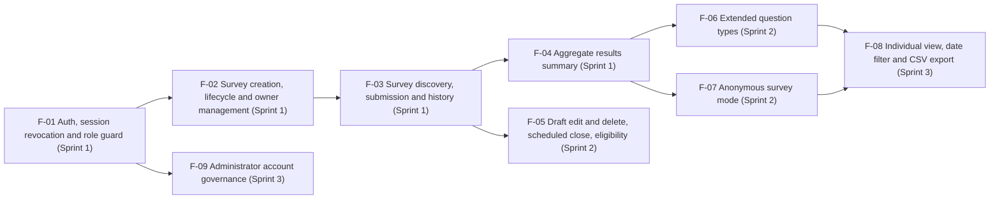

# Feature Inventory

**Product:** Survey and Feedback System (Theme 10: Review, Feedback, and Survey System)  
**Course:** CPE 334 Introduction to Software Engineering in the Age of AI Agents, Semester 1/2026  
**File:** `docs/features.md` | **Version:** 1.0 (approved baseline) | **Date:** 12 November 2026

| Role | Name | Student ID |
|---|---|---|
| Author 1 | Muhammad Asad Aziz | 67070503472 |
| Author 2 | Al Xander James Codino Ybanez | 67070503450 |

**Repository:** [https://github.com/Muhammad-Asad-Aziz/CPE334-GuessLess](https://github.com/Muhammad-Asad-Aziz/CPE334-GuessLess)

### Revision history

| Version | Date | Author | Change |
|---|---|---|---|
| 0.1 | 2026-11-05 | Muhammad Asad Aziz & Al Xander James Codino Ybanez | Initial complete feature inventory aligned with `docs/srs.md` v0.1 |
| 0.2 | 2026-11-06 | Muhammad Asad Aziz | Aligned with `docs/srs.md` v0.2 and `docs/system-sds.md` v0.2: API paths use `/api/v1`; FR-09 anonymous variant traced to F-07; BR-03 verified at rule level in Sprint 1; requirement links reconciled with `docs/traceability.md`; dependency diagram corrected |
| 0.3 | 2026-11-07 | Muhammad Asad Aziz (AI-assisted review) | Aligned with `docs/srs.md` v0.3: incomplete drafts and publish checks (F-02); own-responses list (F-03); close-date and eligibility rules (F-05); BR-14 added to F-07 and F-08; F-09 no longer optional; NFR-11 and NFR-12 added; system responsibilities SR-01 to SR-06 added for cross-cutting NFRs; status column and status legend added |
| 1.0 | 2026-11-12 | Muhammad Asad Aziz & Al Xander James Codino Ybanez | Partner review complete; aligned with `docs/srs.md` v1.0 and `docs/traceability.md` v1.0; feature inventory approved as v1.0 baseline |

---

## 1. Purpose

This document defines the complete product feature inventory across Sprints 1–3 for the **Survey and Feedback System** (`CPE334-GuessLess`). Every feature has a stable ID (`F-01` to `F-09`), a bounded scope, assigned actors (`Survey Owner`, `Respondent`, `System Administrator`), mapped requirements from `docs/srs.md` (`FR`, `BR`, `NFR`), feature dependencies, a planned sprint and a status. Cross-cutting NFRs that no single feature owns are assigned to named system responsibilities (`SR-01` to `SR-06`, Section 3). Requirement-to-verification traceability is maintained in `docs/traceability.md`, and system-wide technical design is defined in `docs/system-sds.md`.

### Status values

Used here and in `docs/traceability.md`. A status only moves forward when its evidence exists.

| Status | Meaning | Evidence |
|---|---|---|
| Planned | Allocated to a sprint; contract not yet written | Row in this inventory |
| Specified | Feature contract (design, AC, STS) committed | Commit of `docs/sprints/sprint-N/` |
| Implemented | Code merged into the sprint staging branch through a reviewed PR | PR link |
| Verified | All planned tests for the feature ran and passed on the release commit | Test output tied to the commit |
| Accepted | Released on `main` with a recorded tag | Release tag |

---

## 2. Complete Feature Inventory Matrix

| Feature ID | Feature Name | Actors | Short Description & Scope | Related Requirements (`docs/srs.md`) | Dependencies | Planned Sprint | Status |
|---|---|---|---|---|---|---|---|
| **F-01** | **Authentication, Session Revocation & Role Guard** | All (`Survey Owner`, `Respondent`, `System Administrator`), Unauthenticated visitor | Local email/password login for seeded accounts issuing a JWT (expiry ≤ 60 min), server-side token revocation on logout, current-user identity retrieval (`/api/v1/auth/me`), rejection of server-owned fields sent by the client, and server-side role/ownership enforcement. | FR-05, FR-06, FR-07, BR-08, BR-13 (mechanism in Sprint 1; verified in Sprint 3 with F-09), NFR-02, NFR-03, NFR-04, NFR-05, NFR-08, NFR-09, NFR-11 (Sprint 3, with SR-06) | None (Foundation) | **Sprint 1** | Planned |
| **F-02** | **Survey Creation, Lifecycle & Owner Management (Identified MVP)** | Survey Owner | Create `DRAFT` surveys in `IDENTIFIED` mode with up to 30 ordered questions (`single-choice` with up to 10 options and `rating` 1–5); a draft may be saved incomplete. List own surveys with effective status and response counts, publish a `DRAFT` only when it passes every publish check, close an open survey, and reject every other lifecycle transition. | FR-01, FR-02, FR-10, FR-11, BR-03, BR-04, BR-05, BR-08, NFR-04, NFR-05, NFR-07 | F-01 | **Sprint 1** | Planned |
| **F-03** | **Survey Discovery, Response Submission & Respondent History** | Respondent | Browse open eligible surveys with responded indicators, display the survey response mode (`IDENTIFIED` or `ANONYMOUS`) before submission, validate and atomically store one response per Respondent per survey, list own responses (including closed surveys) and open own submitted answers for `IDENTIFIED` surveys (anonymous surveys show only the participation day; see F-07). | FR-03, FR-08, FR-09, BR-01, BR-02, BR-06, BR-07, BR-08, NFR-01, NFR-04, NFR-05, NFR-06, NFR-07 | F-01, F-02 | **Sprint 1** | Planned |
| **F-04** | **Aggregate Survey Results Summary** | Survey Owner | Compute and display aggregate results for the owner's `PUBLISHED` or `CLOSED` survey: total responses, per-option count and percentage (1 decimal place) for single-choice questions, and answer count, mean (2 decimal places) and 1–5 distribution for rating questions. A `DRAFT` survey has no summary. | FR-04, BR-05, BR-07, BR-08, NFR-01, NFR-04, NFR-05 | F-01, F-02, F-03 | **Sprint 1** | Planned |
| **F-05** | **Draft Editing, Deletion, Scheduled Close & Eligibility Control** | Survey Owner, Respondent | Edit or delete own `DRAFT` surveys; after publication edit only title and description, plus close date and eligibility while the survey is open. Configure an automatic close date that must be in the future and is frozen once the survey closes (no reopen). Restrict eligibility to all Respondents or a selected list of at least one Respondent, keeping existing responses. | FR-12, FR-13, FR-14, FR-15, BR-02, BR-03, BR-04, BR-09, BR-12 | F-02, F-03 | **Sprint 2** | Planned |
| **F-06** | **Extended Question Types (Multiple-Choice & Free-Text)** | Survey Owner, Respondent | Add multi-select multiple-choice questions and free-text questions (up to 1,000 chars) to surveys, validate answers on submission, and extend aggregate summaries with multi-select option counts and unlinked free-text response lists. | FR-16, BR-06 | F-02, F-03, F-04 | **Sprint 2** | Planned |
| **F-07** | **Privacy-by-Design Anonymous Survey Mode** | Survey Owner, Respondent | Create and answer surveys in `ANONYMOUS` mode using separation between participation records and answer data, Asia/Bangkok day-precision answer dates, complete identity omission across UI/API, small-group suppression (`< 5` responses), release of results only after the survey closes, and a respondent view that shows only the day of participation. | FR-04 (anonymous variant), FR-09 (anonymous variant), FR-17, BR-01, BR-10, BR-11, BR-14 | F-02, F-03, F-04 | **Sprint 2** | Planned |
| **F-08** | **Individual Response Inspection, Date-Filtered Analysis & CSV Export** | Survey Owner | View individual respondent submissions (with display name and timestamp) for `IDENTIFIED` surveys only, filter aggregate summaries by a range of calendar days with daily response counts (anonymous surveys: counts only), and export summaries and eligible individual responses as CSV. | FR-18, FR-19, FR-20, BR-05, BR-10, BR-11, BR-14 | F-04, F-06, F-07 | **Sprint 3** | Planned |
| **F-09** | **System Administrator Account Governance** | System Administrator | List seeded user accounts and enable or disable accounts (except the administrator's own), immediately blocking login and rejecting existing tokens of disabled accounts while preventing Administrator access to any survey, response, or result. | FR-21, BR-08, BR-13 | F-01 | **Sprint 3** | Planned |

---

## 3. System Responsibilities (cross-cutting NFRs)

Some NFRs are properties of the whole system rather than of one feature. Each is owned by a named system responsibility so that its establishment and verification are allocated to a sprint. Features that contribute to an NFR are still listed in Section 2.

| ID | Responsibility | Scope | Related Requirements | Established | Verified |
|---|---|---|---|---|---|
| **SR-01** | Build, migration & seed pipeline | `README.md` commands, `npm run setup`, Prisma migrations, repeatable seed (each role), separate test database | NFR-10 | Sprint 1 | Sprint 1 (clean-environment walkthrough); re-checked in Lab 5 with Docker |
| **SR-02** | Persistence layer | PostgreSQL schema, unique/check/foreign-key constraints, indexes, transactions, benchmark data set | NFR-01, NFR-06, NFR-07 | Sprint 1 | Sprint 1 locally; NFR-01 and NFR-07 re-verified on GCP in Sprint 3 |
| **SR-03** | Shared UI layout & accessibility | Mobile-first layout, navigation bar, labels, keyboard operation, loading/empty/error states | NFR-04, NFR-12 | Sprint 1 | NFR-04 in Sprint 1 and Sprint 3; NFR-12 in Sprint 3 |
| **SR-04** | API error handling & logging | Central error handler, error format, redacted structured logs | NFR-08 | Sprint 1 | Sprint 1 |
| **SR-05** | Configuration & secret handling | `config.ts` start-up validation (`JWT_SECRET` ≥ 32 chars, `BCRYPT_COST` ≥ 10 outside tests), `.env.example`, secret scanning | NFR-02 (cost rule), NFR-09 | Sprint 1 | Sprint 1 (start-up tests, local scan); secret scan in CI from Lab 5 |
| **SR-06** | Login throttling (security hardening) | Per-IP limit on failed logins with HTTP 429 | NFR-11 | Sprint 3 | Sprint 3 |

---

## 4. Feature Scope & Sprint Boundaries

### 4.1 Sprint 1 Feature Bundle (Core End-to-End Vertical Slice)
* **F-01: Authentication, Session Revocation & Role Guard**
  * **Included:** Seeded account login (`FR-05`), JWT issuance with ≤ 60-minute expiry (`NFR-03`), server-side token revocation on logout (`FR-06`), `/api/v1/auth/me` identity endpoint (`FR-07`), bcrypt/Argon2id password hashing (`NFR-02`), rejection of server-owned fields in request bodies (`BR-08`), role guard middleware enforcing one role per account (`BR-08`, `NFR-05`), and the active-account check on every request that `BR-13` later relies on.
  * **Excluded:** Self-registration, password reset, external OAuth/SSO (`docs/srs.md` Section 1.5); login throttling (`NFR-11`, Sprint 3).
* **F-02: Survey Creation, Lifecycle & Owner Management (Identified MVP)**
  * **Included:** Creating `DRAFT` surveys in `IDENTIFIED` mode with up to 30 ordered `single-choice` or `rating` (1–5) questions, saved incomplete if needed (`FR-01`); listing the owner's surveys with effective status and response counts (`FR-10`); publishing only after every publish check passes, with all failed checks reported (`FR-02`, `BR-04`); rejecting every invalid transition, including closing a `DRAFT` (`BR-04`); the rule that locks questions upon publication (`BR-03`, verified at domain-rule level because the edit endpoint arrives in Sprint 2); closing an open survey (`FR-11`); and enforcing owner-only access (`BR-05`).
  * **Excluded:** Editing/deleting saved drafts (`F-05`), scheduled close dates (`F-05`), selected-respondent eligibility (`F-05`), multiple-choice/free-text questions (`F-06`), and `ANONYMOUS` mode (`F-07`), which are scheduled for Sprint 2.
* **F-03: Survey Discovery, Response Submission & Respondent History**
  * **Included:** Listing open surveys for Respondents with "already responded" indicators (`FR-08`), showing the survey's response mode before submission (`FR-03`), validating all answer constraints (`BR-06`), enforcing single submission per Respondent (`BR-01`), including under 20 concurrent requests (`NFR-06`), rejecting `DRAFT`/`CLOSED` survey submissions (`BR-02`), listing own responses including closed surveys and viewing one's own submitted response in `IDENTIFIED` surveys (`FR-09`, `BR-07`); the anonymous variant of `FR-09` is delivered in Sprint 2 by `F-07`.
  * **Excluded:** Editing or deleting a submitted response.
* **F-04: Aggregate Survey Results Summary**
  * **Included:** Owner-only aggregate dashboard (`FR-04`, `BR-05`, `BR-07`) displaying total stored responses, option counts and percentages for single-choice questions, and answer count, arithmetic mean, and 1–5 frequency distribution for rating questions, with the rounding defined in `FR-04`, meeting the `< 300 ms` p95 latency target (`NFR-01`).
  * **Excluded:** Anonymous-mode suppression (`F-07`); date-range filtering, individual response drill-down and CSV export (`F-08`).

### 4.2 Sprint 2 Feature Bundle (Workflow & Privacy Expansion)
* **F-05: Draft Editing, Deletion, Scheduled Close & Eligibility Control**
  * Delivers draft survey editing (`FR-12`) and deletion (`FR-13`, `BR-12`), post-publication edits limited to title and description plus close date and eligibility while open (`BR-03`, including its API/UI verification), automatic scheduled closure with a frozen close date after closing (`FR-14`, `BR-02`, `BR-04`), and selected-respondent eligibility lists (`FR-15`, `BR-09`).
* **F-06: Extended Question Types (Multiple-Choice & Free-Text)**
  * Delivers multi-select choice questions and free-text questions up to 1,000 characters (`FR-16`), server-side validation rules (`BR-06`), and summary aggregation for both new types.
* **F-07: Privacy-by-Design Anonymous Survey Mode**
  * Delivers `ANONYMOUS` surveys (`FR-17`) backed by a participation record decoupled from answer rows, calendar-day submission dates (`BR-10`), small-group result suppression when total responses are fewer than 5 (`BR-11`), release of results only after the survey closes (`BR-14`), and a respondent view that shows only the participation day instead of answers (`FR-09`, anonymous variant).

### 4.3 Sprint 3 Feature Bundle (Advanced Analytics, Export & Administration)
* **F-08: Individual Response Inspection, Date-Filtered Analysis & CSV Export**
  * Delivers individual response browsing for `IDENTIFIED` surveys (`FR-18`), calendar-day range filtering with daily response counts (`FR-19`), and CSV export (`FR-20`) while enforcing anonymous identity protection (`BR-10`), small-group suppression (`BR-11`) and release only after close (`BR-14`).
* **F-09: System Administrator Account Governance**
  * Delivers the `System Administrator` capability to list and enable/disable accounts (`FR-21`), immediately invalidating access for disabled accounts (`BR-13`) while blocking Administrator access to all survey and response data (`BR-08`).
* **SR-06: Login throttling** (`NFR-11`) and the final verification of **SR-03** accessibility (`NFR-12`) are also completed in Sprint 3.

---

## 5. Feature Dependency Diagram

Arrows show the direct dependency chain. Dependencies that follow through the chain (for example, F-04 also needs F-01 and F-02) are listed in the matrix in Section 2.

---
