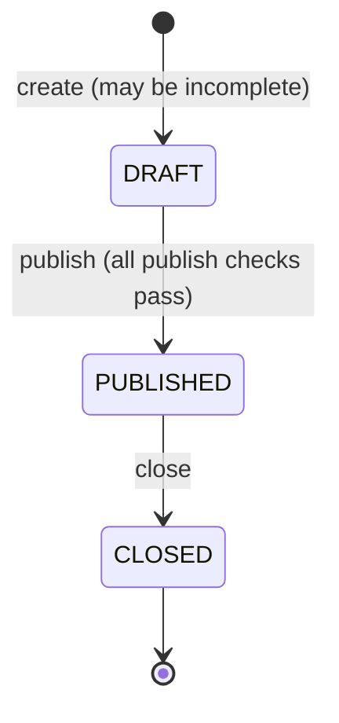

# F-02 Feature Contract: Survey Creation, Lifecycle & Owner Management (Identified MVP)

**Sprint:** 1 | **File:** `docs/sprints/sprint-1/F-02-survey-lifecycle.md` | **Version:** 1.0 (Specified) | **Date:** 12 November 2026
**Baseline:** `docs/srs.md` v1.0, `docs/system-sds.md` v1.0 | **Status:** Specified
**Lead:** Al Xander James Codino Ybanez | **Reviewer:** Muhammad Asad Aziz

### Revision history

| Version | Date | Author | Change |
|---|---|---|---|
| 0.1 | 2026-11-07 | Muhammad Asad Aziz (Author 1, AI-assisted draft) | Initial contract |
| 1.0 | 2026-11-12 | Muhammad Asad Aziz & Al Xander James Codino Ybanez | Partner review complete; contract approved as v1.0 (Specified) before implementation |

---

## 1. Identification

| Item | Value |
|---|---|
| Feature | F-02 Survey Creation, Lifecycle & Owner Management (Identified MVP) |
| Functional requirements | FR-01 Create Survey, FR-02 Publish Survey, FR-10 List My Surveys, FR-11 Close Survey |
| Business rules | BR-03 Questions immutable after publication (domain rule only in Sprint 1), BR-04 Lifecycle and publish checks, BR-05 Owner acts only on own surveys, BR-08 Role decides actions |
| NFRs | NFR-04 (builder, list and detail screens), NFR-05 (owner routes), NFR-07 (surveys survive restart) |
| Actors | Survey Owner (all operations); Respondent and Administrator (denied) |
| Depends on | F-01 (authentication, `requireRole`, migrations, seeded accounts) |
| Used by | F-03 (published surveys are answered), F-04 (summary of published or closed surveys) |
| Not in this feature | Editing or deleting drafts, close dates, eligibility lists (F-05, Sprint 2); multiple-choice and free-text questions (F-06); `ANONYMOUS` mode (F-07) |

---

## 2. Feature-level design

### 2.1 Lifecycle



Only the two transitions shown are allowed (`canTransition`). Every other request — publishing a `PUBLISHED` or `CLOSED` survey, closing a `DRAFT` or `CLOSED` survey — is rejected with `409 INVALID_STATE_TRANSITION` and changes nothing. There is no endpoint that returns a survey to `DRAFT`. In Sprint 1 there is no close date, so the effective status equals the stored status; the code still reads status through `effectiveStatus(survey, now)` so that Sprint 2 needs no change here.

### 2.2 Workflows

**Create (FR-01)**: the owner builds the survey on `/my-surveys/new` and clicks "Save draft". The API validates the body against the save-draft limits (Section 2.3), creates the survey with `ownerId` = the caller, status `DRAFT`, mode `IDENTIFIED`, eligibility `ALL`, and creates its questions and options in one transaction, with positions taken from the array order (starting at 1). It returns the full survey.

**Publish (FR-02, BR-04)**, in this order:
1. Load the survey with `where { id, ownerId: caller }`. Not found → `404`.
2. If its effective status is not `DRAFT` → `409 INVALID_STATE_TRANSITION`.
3. Run `publishChecks(survey)`, which returns **every** failed check:
   - title empty or only spaces → `{ field: "title", issue: "must not be empty to publish" }`
   - no questions → `{ field: "questions", issue: "at least 1 question is required to publish" }`
   - each choice question with fewer than 2 options → `{ field: "questions[i].options", issue: "a choice question needs at least 2 options to publish" }` (`i` is the zero-based index in position order)
   If any fail → `400 VALIDATION_ERROR` with all of them in `details`; nothing changes.
4. Update with a conditional write (`where { id, ownerId, status: 'DRAFT' }`) setting `status = PUBLISHED`, `publishedAt = now`. If no row was updated because another request changed the status first → `409 INVALID_STATE_TRANSITION`.

**Close (FR-11)**: load own survey (`404` if not found); if effective status is not `PUBLISHED` → `409`; conditional update (`where { …, status: 'PUBLISHED' }`) setting `status = CLOSED`, `closedAt = now`. Responses are not touched.

**List (FR-10)**: own surveys only, newest first, paginated, each with effective status and response count (`COUNT` of `Response` rows grouped by survey).

**Read one**: own survey with ordered questions and options.

### 2.3 Validation (save-draft limits, SRS Section 6)

| Field | Rule when saving a draft |
|---|---|
| `title` | Optional string, trimmed, 0–120 characters (default `""`) |
| `description` | Optional string, 0–1,000 characters (default `""`) |
| `mode` | Optional; only `"IDENTIFIED"` is accepted in Sprint 1 (`"ANONYMOUS"` → `400`, issue "is not available yet") |
| `questions` | Optional array, 0–30 items (default `[]`) |
| `questions[i].type` | Required; `"SINGLE_CHOICE"` or `"RATING"` in Sprint 1 |
| `questions[i].text` | Required string, trimmed, 1–300 characters |
| `questions[i].required` | Optional boolean, default `true` |
| `questions[i].options` | `SINGLE_CHOICE`: optional array of 0–10 items. `RATING`: must be absent or empty (`400` otherwise) |
| `questions[i].options[j].text` | Required string, trimmed, 1–100 characters |
| Any other field (for example `ownerId`, `status`, `publishedAt`, `id`, `position`) | Not allowed (strict schema) → `400` |

The rating scale is fixed at 1–5 and is not configurable per question.

### 2.4 Business rules applied

| Rule | Application in F-02 |
|---|---|
| BR-03 | Domain function `checkSurveyChange(status, change)` in `domain/surveyLifecycle.ts`: when status is `PUBLISHED` or `CLOSED`, any change of kind add/remove/reorder question, change question text/type/required, add/remove/change option, or change mode returns `SURVEY_LOCKED`; title and description changes are allowed; for `DRAFT` every change is allowed. No Sprint 1 endpoint edits a survey, so the rule is verified by unit tests now and through the API with FR-12 in Sprint 2 (CHG-02) |
| BR-04 | `canTransition(from, to)` allows only `DRAFT→PUBLISHED` and `PUBLISHED→CLOSED`; `publishChecks` as above; database check constraints `survey_published_at_chk` and `survey_closed_at_chk` |
| BR-05 | Every owner query is scoped with `ownerId = caller`; a miss gives `404` with no data, identical to a non-existent id |
| BR-08 | All routes use `requireRole('SURVEY_OWNER')`; Respondents and Administrators get `403` |

### 2.5 Failure and boundary cases

| Case | Result |
|---|---|
| Title of 120 characters; 30 questions; 10 options; question text of 300; option text of 100 | Accepted |
| Title of 121; 31 questions; 11 options; question text of 0 or 301; option text of 0 or 101 | `400` naming the field |
| Empty title and no questions | Accepted as an incomplete draft; shown as "Untitled survey" |
| Publish draft with title "   " | `400`, `details` contains `title` |
| Publish draft with a choice question that has 1 option | `400`, `details` contains `questions[i].options` |
| Publish a draft that fails several checks | `400` listing every failed check |
| Publish twice at the same moment | One `200`, one `409` |
| Survey id that is not a UUID | `404` |

### 2.6 Permissions

| Operation | Unauthenticated | Respondent | Survey Owner | Administrator |
|---|---|---|---|---|
| Create survey | 401 | 403 | Allow (owner = caller) | 403 |
| List own surveys | 401 | 403 | Own only | 403 |
| Read survey | 401 | 403 | Own only; others 404 | 403 |
| Publish, close | 401 | 403 | Own only; others 404 | 403 |

---

## 3. UI specification

| Screen | Behavior |
|---|---|
| `/my-surveys` | List of own surveys: title (or "Untitled survey"), status badge (Draft, Published, Closed), response count, created, published and closed dates in Bangkok time. "Create survey" button. Empty state: "No surveys yet. Create your first survey." Table on wide screens, stacked cards below 768 px. Skeleton while loading; error banner with `requestId` on failure. |
| `/my-surveys/new` | Title and description fields; response mode shown as "Identified — respondents are told that their answers are linked to their name." Add up to 30 questions; each has a type selector (Single choice, Rating 1–5), text, "Required" checkbox (checked by default), and for single choice an options list (add, remove, up to 10). Questions can be moved up and down and removed. Client checks mirror Section 2.3; an incomplete survey can still be saved. "Save draft" is disabled while sending; on success the browser goes to the survey's detail page with the message "Draft saved." Server field errors from `details` are shown next to the fields. |
| `/my-surveys/:surveyId` | Read-only view of title, description, mode, status, dates and questions in order. **Draft**: "Publish" button; on `400` a list "This survey cannot be published yet:" with one line per failed check; text "Editing drafts arrives in Sprint 2." **Published**: "Close survey" button with a confirmation dialog "Closing is final. No new responses will be accepted."; "View summary" link. **Closed**: "View summary" link. On `404` shows "Survey not found." |

---

## 4. API specification

### 4.1 `POST /api/v1/surveys` (Survey Owner)

Request:

```json
{
  "title": "Lab feedback",
  "description": "Week 10 lab",
  "mode": "IDENTIFIED",
  "questions": [
    { "type": "SINGLE_CHOICE", "text": "Was the lab clear?", "required": true,
      "options": [ { "text": "Yes" }, { "text": "No" } ] },
    { "type": "RATING", "text": "Rate the lab", "required": true }
  ]
}
```

`201 Created` with the survey detail (Section 4.3 shape). Errors: `400 VALIDATION_ERROR`, `401`, `403`.

### 4.2 `GET /api/v1/surveys?page=1&pageSize=20` (Survey Owner)

`200 OK`:

```json
{
  "data": [
    { "id": "s1…", "title": "Lab feedback", "status": "PUBLISHED", "responseCount": 2,
      "createdAt": "2026-11-07T02:00:00.000Z", "publishedAt": "2026-11-07T02:05:00.000Z",
      "closeAt": null, "closedAt": null }
  ],
  "meta": { "page": 1, "pageSize": 20, "total": 1 }
}
```

Errors: `400` (page or pageSize out of range), `401`, `403`.

### 4.3 `GET /api/v1/surveys/{id}` (Survey Owner, own)

`200 OK`:

```json
{
  "data": {
    "id": "s1…", "title": "Lab feedback", "description": "Week 10 lab",
    "mode": "IDENTIFIED", "status": "DRAFT", "eligibility": "ALL",
    "createdAt": "…", "publishedAt": null, "closeAt": null, "closedAt": null,
    "responseCount": 0,
    "questions": [
      { "id": "q1…", "position": 1, "type": "SINGLE_CHOICE", "text": "Was the lab clear?", "required": true,
        "options": [ { "id": "o1…", "position": 1, "text": "Yes" }, { "id": "o2…", "position": 2, "text": "No" } ] },
      { "id": "q2…", "position": 2, "type": "RATING", "text": "Rate the lab", "required": true, "options": [] }
    ]
  }
}
```

The response never contains `ownerId`. Errors: `401`, `403`, `404`.

### 4.4 `POST /api/v1/surveys/{id}/publish` (Survey Owner, own)

Request: no body. `200 OK` with the survey detail (`status` `PUBLISHED`, `publishedAt` set). Errors: `400 VALIDATION_ERROR` (failed checks, all listed), `401`, `403`, `404`, `409 INVALID_STATE_TRANSITION`.

```json
{ "error": { "code": "VALIDATION_ERROR", "message": "The survey cannot be published yet.",
  "details": [
    { "field": "title", "issue": "must not be empty to publish" },
    { "field": "questions[0].options", "issue": "a choice question needs at least 2 options to publish" }
  ], "requestId": "…" } }
```

### 4.5 `POST /api/v1/surveys/{id}/close` (Survey Owner, own)

Request: no body. `200 OK` with the survey detail (`status` `CLOSED`, `closedAt` set). Errors: `401`, `403`, `404`, `409 INVALID_STATE_TRANSITION`.

---

## 5. Data specification

| Item | Specification |
|---|---|
| Tables used | `Survey` (`id`, `ownerId`, `title`, `description`, `mode`, `status`, `eligibility`, `publishedAt`, `closeAt`, `closedAt`, `createdAt`, `updatedAt`), `Question` (`id`, `surveyId`, `position`, `type`, `text`, `required`), `Option` (`id`, `questionId`, `position`, `text`); reads `Response` for counts |
| Migration | No change. All tables and constraints come from F-01's `0001_initial_schema` and `0002_check_constraints` |
| Constraints relied on | FK `Survey.ownerId`; unique `(surveyId, position)` and `(questionId, position)`; `question_position_chk`, `option_position_chk`; `survey_published_at_chk`; `survey_closed_at_chk`; column lengths 120 / 1,000 / 300 / 100 |
| Seed | `prisma/seed.ts` adds S-PUB, S-DRAFT and S-CLOSED (`README.md` Section 3.3), upserted by fixed ids so the seed is repeatable |

---

## 6. Acceptance criteria

### AC-F02-01 — Draft validation follows the save-draft limits (FR-01)

**Scenario Outline: boundary values when saving a draft**
- **Given** a create-survey request that is valid except for `<change>`
- **When** the request is validated
- **Then** the result is `<result>`

| change | result |
|---|---|
| title of 0 characters, no questions | accepted |
| title of 120 characters | accepted |
| title of 121 characters | rejected, field `title` |
| description of 1,001 characters | rejected, field `description` |
| 30 questions | accepted |
| 31 questions | rejected, field `questions` |
| question text of 0 or 301 characters | rejected, field `questions[i].text` |
| single-choice question with 0 options | accepted |
| single-choice question with 11 options | rejected, field `questions[i].options` |
| option text of 0 or 101 characters | rejected, field `questions[i].options[j].text` |
| rating question with options | rejected, field `questions[i].options` |
| `mode` `ANONYMOUS` | rejected, field `mode` |
| question type `MULTIPLE_CHOICE` | rejected, field `questions[i].type` |
| extra field `ownerId` | rejected, field `ownerId` |

### AC-F02-02 — Owner creates and retrieves a draft (FR-01)

**Scenario: complete draft**
- **Given** owner1 is logged in
- **When** owner1 creates a survey titled "Lab feedback" with a single-choice question (options "Yes", "No") followed by a rating question
- **Then** the response is `201` with status `DRAFT`, mode `IDENTIFIED`, and the two questions at positions 1 and 2 with options at positions 1 and 2
- **And** `GET /api/v1/surveys/{id}` by owner1 returns the same survey
- **And** the stored survey's `ownerId` is owner1's id

**Scenario: incomplete draft**
- **Given** owner1 is logged in
- **When** owner1 saves a survey with an empty title and no questions
- **Then** the response is `201` with status `DRAFT`, title `""` and no questions
- **And** the detail page shows "Untitled survey" with a "Publish" button

**Scenario: builder in the UI**
- **Given** owner1 is on `/my-surveys/new`
- **When** owner1 enters a title, adds a single-choice question with two options and a rating question, and clicks "Save draft"
- **Then** the detail page of the new draft is shown with "Draft saved." and both questions in order

### AC-F02-03 — Owner publishes a complete draft (FR-02)

**Scenario: successful publish**
- **Given** owner1 owns a complete draft D (non-blank title, a single-choice question with 2 options, a rating question)
- **When** owner1 sends `POST /api/v1/surveys/{D}/publish`
- **Then** the response is `200` with status `PUBLISHED` and `publishedAt` set
- **And** `GET /api/v1/available-surveys` by resp1 includes D
- **And** in the UI the detail page shows status "Published" and a "Close survey" button

### AC-F02-04 — Publishing is rejected until every check passes (FR-02, BR-04)

**Scenario Outline: incomplete draft cannot be published**
- **Given** owner1 owns a draft whose `<defect>`
- **When** owner1 sends `POST /api/v1/surveys/{id}/publish`
- **Then** the response is `400 VALIDATION_ERROR` whose `details` contain `<field>`
- **And** the survey is still `DRAFT` with `publishedAt` null
- **And** the survey does not appear in resp1's available surveys

| defect | field |
|---|---|
| title is "" | `title` |
| title is "   " (spaces only) | `title` |
| has no questions | `questions` |
| first question is single-choice with 1 option | `questions[0].options` |
| first question is single-choice with 0 options | `questions[0].options` |

**Scenario: every failed check is reported**
- **Given** owner1 owns a draft with an empty title and a single-choice question with 1 option
- **When** owner1 publishes it
- **Then** `details` contains both `title` and `questions[0].options`
- **And** the UI lists both under "This survey cannot be published yet:"

### AC-F02-05 — Owner lists only their own surveys (FR-10)

**Scenario: list with mixed statuses**
- **Given** owner1 owns a `DRAFT`, a `PUBLISHED` survey with 2 responses and a `CLOSED` survey, and owner2 owns one survey
- **When** owner1 sends `GET /api/v1/surveys`
- **Then** the response is `200` with exactly owner1's 3 surveys and `meta.total` 3
- **And** each item has title, status, `responseCount` (2 for the published one), `createdAt`, `publishedAt`, `closeAt` and `closedAt`
- **And** owner2's survey is not in the list

**Scenario: no surveys**
- **Given** owner2 owns no surveys
- **When** owner2 opens `/my-surveys`
- **Then** the page shows "No surveys yet. Create your first survey."

**Scenario: page size boundary**
- **When** owner1 sends `GET /api/v1/surveys?pageSize=101`
- **Then** the response is `400 VALIDATION_ERROR` naming `pageSize`

### AC-F02-06 — Owner closes an open survey (FR-11)

**Scenario: close keeps the collected data**
- **Given** owner1 owns a `PUBLISHED` survey P with 2 responses
- **When** owner1 sends `POST /api/v1/surveys/{P}/close`
- **Then** the response is `200` with status `CLOSED` and `closedAt` set
- **And** P's `responseCount` is still 2 and the stored responses are unchanged
- **And** a later submission to P by resp3 is rejected with `409 SURVEY_NOT_OPEN`
- **And** P no longer appears in resp3's available surveys

**Scenario: close in the UI**
- **Given** owner1 is on P's detail page
- **When** owner1 clicks "Close survey" and confirms
- **Then** the page shows status "Closed" and no "Close survey" button

### AC-F02-07 — Questions cannot change after publication (BR-03, domain rule)

**Scenario Outline: change checked against status**
- **Given** a survey with status `<status>`
- **When** the domain rule checks a change of kind `<change>`
- **Then** the result is `<result>`

| status | change | result |
|---|---|---|
| `PUBLISHED` | add, remove or reorder a question | `SURVEY_LOCKED` |
| `PUBLISHED` | change a question's text, type or required flag | `SURVEY_LOCKED` |
| `PUBLISHED` | add, remove or change an option | `SURVEY_LOCKED` |
| `PUBLISHED` | change the response mode | `SURVEY_LOCKED` |
| `CLOSED` | any of the changes above | `SURVEY_LOCKED` |
| `PUBLISHED` or `CLOSED` | change title or description | allowed |
| `DRAFT` | any change | allowed |

API and UI verification of this rule follow in Sprint 2 with FR-12 (CHG-02).

### AC-F02-08 — Invalid lifecycle transitions are rejected (BR-04)

**Scenario Outline: transition not allowed**
- **Given** owner1 owns a survey in state `<state>`
- **When** owner1 sends `<request>`
- **Then** the response is `409 INVALID_STATE_TRANSITION`
- **And** the survey's status, `publishedAt` and `closedAt` are unchanged

| state | request |
|---|---|
| `PUBLISHED` | `POST /api/v1/surveys/{id}/publish` |
| `CLOSED` | `POST /api/v1/surveys/{id}/publish` |
| `DRAFT` | `POST /api/v1/surveys/{id}/close` |
| `CLOSED` | `POST /api/v1/surveys/{id}/close` |

**Scenario: transition table**
- **Given** the three statuses
- **When** `canTransition(from, to)` is evaluated for every pair
- **Then** only `DRAFT→PUBLISHED` and `PUBLISHED→CLOSED` return true

### AC-F02-09 — An owner cannot act on another owner's survey (BR-05)

**Scenario Outline: other owner's survey**
- **Given** owner1 owns survey S and owner2 is logged in
- **When** owner2 sends `<request>` for S
- **Then** the response is `404 NOT_FOUND` and the body contains none of S's data (no title, questions or counts)
- **And** S is unchanged

| request |
|---|
| `GET /api/v1/surveys/{S}` |
| `POST /api/v1/surveys/{S}/publish` |
| `POST /api/v1/surveys/{S}/close` |

- **And** the same requests with a random non-existent UUID return an identical `404` body apart from `requestId`

**Scenario: a Respondent uses an owner route**
- **Given** resp1 is logged in
- **When** resp1 sends `GET /api/v1/surveys/{S}`
- **Then** the response is `403 FORBIDDEN`

---

## 7. Software Test Specification

| Test ID | AC | Level | Preconditions / input | Action | Expected result | Planned file |
|---|---|---|---|---|---|---|
| TEST-F02-01 | AC-F02-01 | Unit | Create-survey schema; one valid base request | Validate the base request modified by each row of the Examples table | Accepted rows parse successfully; rejected rows fail with an issue on the named path | `tests/unit/surveySchema.test.ts` |
| TEST-F02-02 | AC-F02-02 | API + DB + E2E | owner1 logged in | API: create the complete draft, `GET` it, read the DB row; create the incomplete draft. E2E: build and save the draft on `/my-surveys/new` | API: `201`, positions 1 and 2, `ownerId` = owner1 in DB, `GET` equals the create response; incomplete draft `201` with `title` "". E2E: detail page shows "Draft saved." and both questions | `tests/integration/surveys.test.ts` › "create"; `tests/e2e/owner-survey.spec.ts` › "create draft" |
| TEST-F02-03 | AC-F02-03 | API + E2E | owner1 owns complete draft D; resp1 exists | API: publish D; resp1 lists available surveys. E2E: click "Publish" on D | `200`, `status` `PUBLISHED`, `publishedAt` within the test's time window; D in resp1's list. E2E: status "Published", "Close survey" visible | `tests/integration/surveys.test.ts` › "publish"; `tests/e2e/owner-survey.spec.ts` › "publish" |
| TEST-F02-04 | AC-F02-04 | Unit (TDD) + API + DB | Unit: `publishChecks` with each defect. API: owner1 owns one draft per defect, and one with two defects | Unit: call `publishChecks`. API: publish each draft; read the DB row; resp1 lists available surveys | Unit: returns exactly the expected failed checks. API: `400`, `details` fields as in the table (both for the two-defect draft); DB status `DRAFT`, `publishedAt` null; not in resp1's list | `tests/unit/surveyLifecycle.test.ts` › "publishChecks"; `tests/integration/surveys.test.ts` › "publish rejected" |
| TEST-F02-05 | AC-F02-05 | API + E2E | owner1 owns DRAFT, PUBLISHED (2 responses created by resp1 and resp2), CLOSED; owner2 owns one survey | API: owner1 `GET /surveys`; `GET /surveys?pageSize=101`. E2E: owner2 (no surveys in a fresh fixture) opens `/my-surveys` | API: exactly 3 items, `meta.total` 3, `responseCount` 2 on the published one, owner2's id absent; `400` naming `pageSize`. E2E: empty-state text shown | `tests/integration/surveys.test.ts` › "list"; `tests/e2e/owner-survey.spec.ts` › "empty list" |
| TEST-F02-06 | AC-F02-06 | API + DB + E2E | owner1 owns P (`PUBLISHED`) with 2 responses; resp3 has not answered | API: close P; read P and its responses from the DB; resp3 submits to P; resp3 lists available surveys. E2E: close P through the dialog | `200`, `CLOSED`, `closedAt` set; DB response rows identical before and after; resp3 gets `409 SURVEY_NOT_OPEN`; P not listed. E2E: "Closed" shown, no close button | `tests/integration/surveys.test.ts` › "close"; `tests/e2e/owner-survey.spec.ts` › "close" |
| TEST-F02-07 | AC-F02-07 | Unit (TDD) | `checkSurveyChange` | Evaluate every row of the Examples table | Results exactly as in the table | `tests/unit/surveyLifecycle.test.ts` › "BR-03 question lock" |
| TEST-F02-08 | AC-F02-08 | Unit + API + DB | Unit: `canTransition`. API: owner1 owns one survey in each state of the table | Unit: evaluate all 9 pairs. API: send each request; read the DB row | Unit: only the 2 allowed pairs are true. API: each `409 INVALID_STATE_TRANSITION`; status, `publishedAt`, `closedAt` unchanged | `tests/unit/surveyLifecycle.test.ts` › "canTransition"; `tests/integration/surveys.test.ts` › "invalid transitions" |
| TEST-F02-09 | AC-F02-09 | API + DB | owner1 owns S; owner2 and resp1 logged in | owner2: `GET`, publish, close on S and on a random UUID; resp1: `GET /surveys/{S}` | owner2: every call `404`, body without S's title or questions, bodies equal to the random-UUID responses except `requestId`, S unchanged in DB. resp1: `403` | `tests/integration/surveys.ownership.test.ts` |

Related NFR tests: TEST-NFR-04 (builder, list and detail screens), TEST-NFR-05 (owner routes), TEST-NFR-07 (a created survey survives restart).

---

## 8. Feature Definition of Done

The Product Definition of Done items D-1 to D-10 (`definition-of-done.md`) apply. In addition, F-02 is done when:

- TEST-F02-01 to TEST-F02-09 pass on the PR head commit, with red-then-green commits recorded for TEST-F02-04 and TEST-F02-07.
- TEST-F01-05 (role matrix) and TEST-NFR-03 cover all F-02 routes.
- The seed creates S-PUB, S-DRAFT and S-CLOSED and can be run twice without duplicates.
- The reviewer has checked in the PR that every Prisma query on `Survey` in the owner routes includes `ownerId`, and that no response exposes `ownerId`.
